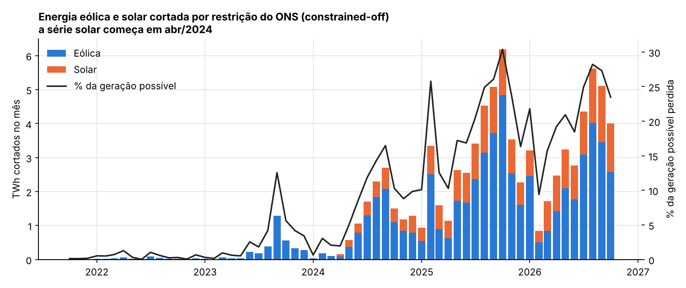
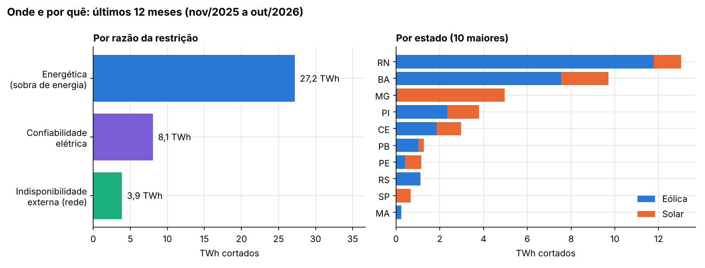
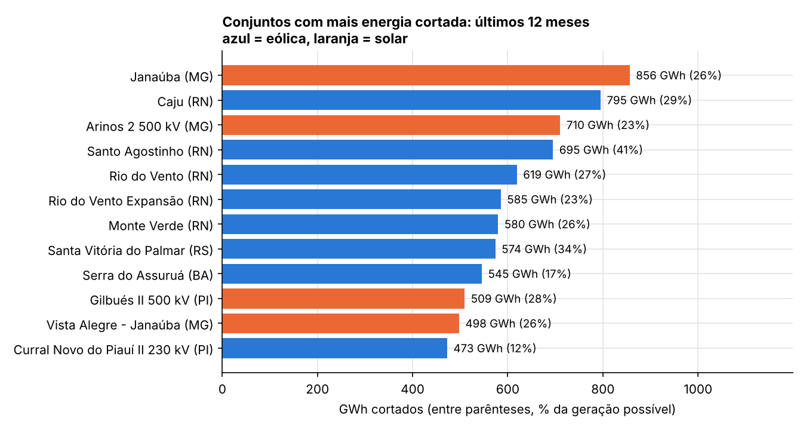
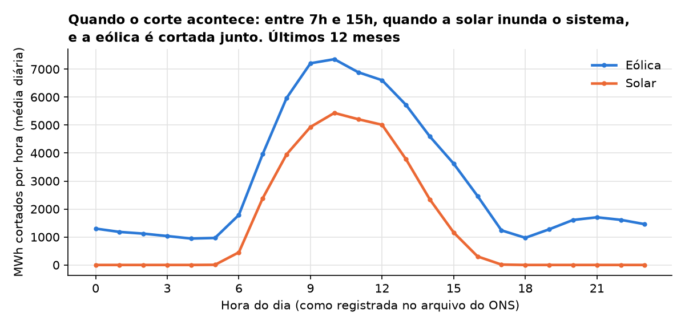
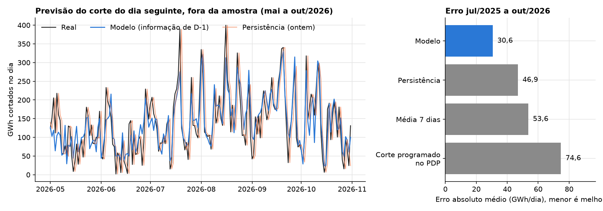
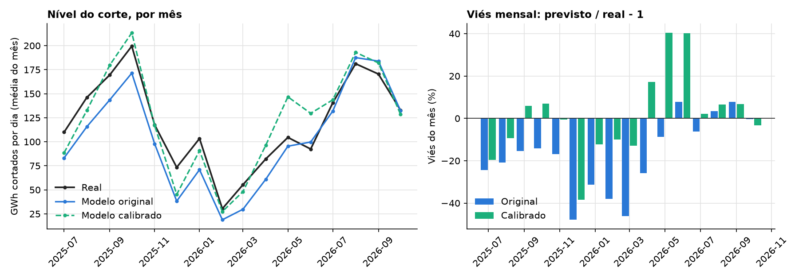

# Curtailment de eólicas e solares no Brasil

[](https://github.com/CaioNepomuceno2/renewables-curtailment/actions/workflows/ci.yml)

-0b7a75)

**Quanta energia renovável o Brasil está deixando de gerar por ordem do ONS, onde, por quê, quanto isso
vale e dá para prever o corte do dia seguinte?**

Este projeto responde com os dados abertos de **restrição de operação por constrained-off** do ONS:
cada meia hora de cada usina ou conjunto eólico (desde out/2021) e solar (desde abr/2024) supervisionado,
com a geração verificada, a geração de referência (o que a usina poderia gerar) e a razão do corte.

## Resultados

### 1. Um quinto da geração eólica e solar possível foi jogada fora

**Últimos 12 meses (nov/2025 a out/2026):**

| | Eólica | Solar | Total |
|---|---|---|---|
| Energia cortada | 26,5 TWh | 12,8 TWh | **39,3 TWh** |
| % da geração possível (verificada + cortada) | 20,4% | 25,5% | **21,8%** |
| Valor pelo CMO do subsistema no instante do corte | R$ 2,04 bi | R$ 0,45 bi | **R$ 2,49 bi** |



**O que isso significa:** de cada 5 MWh que os parques eólicos e solares supervisionados poderiam ter
produzido nos últimos 12 meses, cerca de 1 não foi gerado por ordem do ONS. Para uma usina, isso é receita
que some; para o sistema, é investimento já feito que não vira energia.

O corte era residual até 2022 (0,5% da eólica) e explodiu a partir do 2º semestre de 2023:

| Ano | Energia cortada | % perdida | Valor pelo CMO |
|---|---|---|---|
| 2022 | 0,4 TWh | 0,5% | R$ 0,01 bi |
| 2023 | 3,4 TWh | 3,6% | R$ 0,01 bi |
| 2024 (solar a partir de abr) | 12,8 TWh | 9,4% | R$ 0,96 bi |
| 2025 | 37,2 TWh | 20,7% | R$ 3,22 bi |
| 2026 (jan a out) | 33,5 TWh | 22,1% | R$ 1,67 bi |

### 2. Onde e por quê



* **69% do corte é por razão energética (ENE):** sobra energia no sistema, e o ONS manda reduzir. Outros
  21% são por **confiabilidade elétrica (CNF)** e só 10% por **indisponibilidade externa (REL)**, como falha
  ou limite da rede de transmissão.
* Pelo próprio dicionário de dados do ONS, **só o corte REL tem a geração de referência final enviada à CCEE**
  para apuração de encargos (ESS) por constrained-off. Ou seja, cerca de 90% da energia cortada nos últimos 12
  meses (ENE e CNF) fica fora desse caminho de ressarcimento.
* **O Nordeste concentra 81% do corte** (32,0 TWh). O Rio Grande do Norte sozinho perdeu 11,8 TWh de eólica,
  **31% da sua geração eólica possível**. Minas Gerais lidera a solar (4,9 TWh).
* Os conjuntos mais afetados perderam entre 12% e 49% da geração possível:



### 3. Quando: o corte acompanha o sol, inclusive o da eólica



**80% da energia cortada nos últimos 12 meses** caiu entre 7h e 15h. É quando a geração solar centralizada e a distribuída (dos telhados,
que o ONS não controla) reduzem a carga líquida, e o ONS corta tanto a solar quanto a eólica.

### 4. O corte do dia seguinte é previsível

Para cada dia D, o modelo (LightGBM) usa só o que se sabe no fim de D-1: o corte realizado até D-1, o
calendário, a carga programada para D e a **previsão x programado de eólicas e solares do PDP** (programação
diária do ONS feita em D-1). O teste é fora da amostra, com origem móvel mensal: cada mês é previsto por
um modelo treinado só com os dias anteriores. São 488 dias (jul/2025 a out/2026), com corte médio real de
120 GWh/dia.



| Método (jul/2025 a out/2026) | Erro médio (GWh/dia) | Ganho sobre a persistência | AUC "dia de corte alto" |
|---|---|---|---|
| **Modelo com informação de D-1** | **30,6** | **35%** | **0,91** |
| Persistência (o corte de ontem) | 46,9 | - | 0,83 |
| Média dos últimos 7 dias | 53,6 | -14% | 0,74 |
| Corte programado no PDP, sozinho | 74,6 | -59% | 0,91 |
| Modelo estrito, com realizados só até D-2 | 31,2 | 51% (sobre a persistência de D-2, 63,4) | 0,91 |

* **O PDP subestima o corte em 62%:** a programação do dia anterior prevê só 38% da energia que acaba
  sendo cortada em tempo real. Mas ela ordena bem os dias (AUC de 0,91), e por isso é a variável mais
  importante do modelo (57% do ganho), que aprende a corrigir a escala.
* Nos 20% de dias com maior previsão, 95% foram de fato dias de corte alto (acima do 3º quartil do treino),
  contra 45% na média.
* A carga programada quase não ajuda (39,8 contra 38,2 GWh/dia sem o PDP); o que carrega informação é o
  próprio programa de eólicas e solares.

**O que isso significa:** na véspera já dá para saber, com boa confiança, se amanhã será um dia de corte
alto. Os 20% de dias que o modelo aponta como piores tiveram corte médio de 224,1 GWh/dia, quase o dobro da
média (119,8), e concentraram 38% de toda a energia cortada no período de teste.

### 5. Dá para corrigir o nível do total? Só em parte

O modelo subestima o total (viés de -13,0% no período de teste). Testei o fator de nível descrito em
[Calibração de nível](#calibração-de-nível-método-fixado-antes-de-rodar-o-teste), com a regra de aceite
fixada antes de ver o resultado. **A regra não foi cumprida e o padrão continua sendo o modelo original.**



| Jul/2025 a out/2026 (488 dias) | Viés do total | Erro médio (GWh/dia) | WAPE | MAPE | Spearman | AUC | Precisão nos 20% apontados |
|---|---|---|---|---|---|---|---|
| Original, informação de D-1 | -13,0% | 30,6 | 25,5% | 32,9% | 0,870 | 0,913 | 94,9% |
| Calibrado, informação de D-1 | **+2,7%** | **29,1** | **24,3%** | 34,8% | 0,863 | 0,904 | 94,9% |
| Original, estrito (D-2) | -12,7% | 31,2 | 26,1% | 33,5% | 0,861 | 0,909 | 95,9% |
| Calibrado, estrito (D-2) | **+3,0%** | **30,1** | **25,1%** | 36,2% | 0,854 | 0,899 | 93,9% |

O WAPE é o erro absoluto total dividido pelo corte total. O MAPE ignora os dias com corte real abaixo de
10 GWh (26 dos 488) e o Spearman compara os postos de real e previsto em todos os dias.

* **O que melhorou:** o viés do total caiu de -13,0% para +2,7% (D-1) e de -12,7% para +3,0% (D-2). O erro
  médio por dia caiu 1,5 GWh/dia no D-1 e 1,1 no D-2, e o WAPE também.
* **O que piorou:** o ranqueamento. O Spearman caiu de 0,870 para 0,863 e a AUC de 0,913 para 0,904 (no D-2,
  de 0,861 para 0,854 e de 0,909 para 0,899), mais que os 0,005 de tolerância fixados antes. O MAPE também
  subiu. Por isso o calibrado não vira o padrão. Dentro de cada mês a ordem dos dias não muda (o fator é o
  mesmo no mês inteiro, e há teste para isso); a piora vem de comparar meses com fatores diferentes.
* **O fator chega atrasado:** em mai e jun/2026 ele vinha de meses de subestimação forte (fator de 1,54 e
  1,30), mas o modelo original já tinha quase parado de errar para baixo (viés mensal de -8,7% e +7,9%), e o
  calibrado passou para +40% nos dois meses. Por outro lado, o erro mensal médio do total caiu de 19,7% para
  14,5%, e os meses com erro acima de 20% passaram de 7 para 3 (o pior mês foi -47,9% no original, em
  dez/2025, e +40,4% no calibrado). Esses números por mês foram calculados depois de ver o resultado e não
  fazem parte da regra de aceite (`reports/previsao_calibracao_mensal.csv`).
* **Não depende da janela:** com 60 e 180 dias o resultado é do mesmo tipo (viés de +2,7% a +3,4% e Spearman
  de 0,855 a 0,866 no D-1) e nenhuma janela passa na regra (`reports/previsao_calibracao_sensibilidade.csv`).
  A janela de 30 dias não entra na tabela: com o mínimo de 60 dias o fator seria sempre 1, e a linha era
  idêntica à do modelo original.

**O que isso significa:** para escolher *quais dias* são piores, use o modelo original. Para aproximar o
*total* do corte, o fator ajuda em média, mas não segura o nível mês a mês quando o regime muda, e custa um
pouco de ranqueamento. Mais histórico (o PDP aberto só existe desde out/2024) ou um fator que reaja mais
rápido são o caminho natural, e este projeto não testou nenhum dos dois.

## Na prática: o que muda para quem decide

### O problema hoje
* **Gerador e investidor:** 21,8% da geração eólica e solar possível foi cortada nos últimos 12 meses, e em
  10 dos 15 conjuntos mais afetados a perda passou de 25%. Quem tem um parque no RN ou no norte de MG vê a
  receita cair sem saber, com antecedência, quanto e em que dias.
* **Comercializadora e área de contratos:** energia vendida em contrato e não gerada por corte precisa ser
  coberta no mercado de curto prazo. Sem previsão, a cobertura é decidida no escuro.
* **Planejamento e O&M:** paradas de manutenção marcadas em dias de vento ou sol bons perdem geração; as
  mesmas paradas feitas em dias de corte alto quase não custam nada, porque a energia seria cortada de
  qualquer jeito.
* **Planejamento da expansão (transmissão, armazenamento):** a decisão de onde reforçar a rede ou instalar
  baterias depende de saber onde, por qual razão e em que horas a energia é cortada.

### O que se ganha

| Ganho | Quanto | De onde vem o número |
|---|---|---|
| Saber quanto está sendo perdido, por usina/conjunto, razão e hora | 39,3 TWh em 12 meses; 80% entre 7h e 15h; top 15 conjuntos = 23% do total | **Medido** nos dados do ONS (`reports/resumo.json`, `reports/aplicacao.json`) |
| Prever o corte de amanhã com menos erro | 30,6 contra 46,9 GWh/dia da persistência: **16,3 GWh/dia a menos de erro (−35%)** | **Medido** no backtest fora da amostra, 488 dias (`reports/previsao.json`) |
| Identificar os dias de corte alto na véspera | 95% de acerto nos 20% de dias apontados (taxa média de 45%); AUC de 0,91 | **Medido** no backtest |
| Colocar manutenção nos dias que já seriam cortados | Os dias apontados têm corte médio de 224,1 GWh/dia, contra 119,8 na média | **Medido** no backtest (`reports/aplicacao.json`); o ganho em R$ depende da usina |
| Ordem de grandeza do valor para o sistema | R$ 2,49 bi em 12 meses pelo CMO; R$ 3,9 bi a cada R$ 100/MWh | **Estimativa**: valoração pelo CMO, não perda de receita das usinas |

O valor financeiro para uma usina específica não está calculado aqui: ele depende do contrato, do preço de
liquidação, da razão do corte e do ressarcimento. O projeto entrega as quantidades (GWh, horas, razões) que
entram nesse cálculo.

### Por que aplicar
* **A maior parte do corte não tem ressarcimento automático.** Pelo dicionário de dados do ONS, só o corte por
  indisponibilidade externa (REL) tem a geração de referência final enviada à CCEE para apuração de encargos
  (ESS). Nos últimos 12 meses, cerca de 90% da energia cortada (ENE e CNF) ficou fora desse caminho. Para o
  gerador, isso é risco de receita que precisa ser medido e gerenciado.
* **O problema está crescendo, não diminuindo:** 0,5% da eólica em 2022, 20,7% da geração possível em 2025 e
  22,1% em 2026 (jan a out).
* **A programação do ONS sozinha subestima o corte:** o corte programado no PDP prevê só 38% do que acaba
  sendo cortado. Quem planeja só com ele subestima a perda.

### Como aplicar (roteiro de adoção)
1. **Trocar ou complementar os dados abertos pelos internos.** Os que mais melhoram o resultado: medição e
   SCADA da própria usina (disponibilidade real das máquinas), previsão própria de vento e irradiância, as
   ordens de restrição recebidas em tempo real e os contratos (para converter GWh em R$).
2. **Recalibrar para o seu recorte.** O pipeline (`scripts/01` a `05`) roda para o SIN; filtrar por usina,
   conjunto ou subsistema é uma mudança de agregação em `previsao.tabela_diaria`. Retreinar mensalmente, como
   no backtest.
3. **Piloto de 3 meses em paralelo.** Rodar o previsor todo dia sem mudar nenhuma decisão e comparar com o
   que a equipe teria decidido: erro em GWh/dia contra a persistência e acerto nos dias de corte alto.
4. **Rotina diária.** Depois da publicação do PDP em D-1: rodar o robô, gravar a previsão em Parquet, publicar
   no painel (Power BI ou Streamlit) e disparar alerta quando a previsão passar do 3º quartil. Usuários:
   operação comercial e trading (cobertura de contratos), O&M (janelas de manutenção) e planejamento
   (relatório mensal por conjunto e razão).
5. **Critério de sucesso.** Manter no piloto o ganho de pelo menos 30% sobre a persistência e a precisão
   acima de 90% nos dias apontados; e, no caso do O&M, medir a geração perdida por manutenção antes e depois.

### Limites de uso
* Não usar o valor pelo CMO como perda de receita de uma usina, nem como valor de indenização.
* Não usar o previsor para estimar o total de energia sem checar o nível: o modelo original subestima o total
  em 13,0% no período de teste. O fator de nível (seção 5) leva o viés do total a +2,7%, mas errou até 40%
  em meses em que o regime mudou; trate o total previsto como ordem de grandeza.
* O previsor é do SIN como um todo; para uma usina específica, ele precisa ser retreinado com os dados dela.
* A geração de referência é estimada pelo ONS; o corte herda o erro dessa estimativa.

A metodologia completa, com fórmulas, desenho do backtest e premissas, está em
[`docs/metodologia.md`](docs/metodologia.md).

## Decisões de dados

Detalhes em [`docs/dados.md`](docs/dados.md). As principais:

* **Energia cortada = geração não realizada apurada (GNRa) do ONS:** `max(referência - verificada, 0)`, só
  nos patamares em que o ONS limitou a usina (`val_geracaolimitada` não nulo), em MWmed x 0,5 h. Recalculo
  a partir das colunas brutas porque os arquivos antigos não trazem o campo apurado; em ago/2025 os dois
  dão exatamente 3.138,9 GWh (conferência manual com o arquivo bruto completo, refeita em 06/11/2026: o
  pipeline guarda só as colunas enxutas).
* **% perdida = cortada / (verificada + cortada)**, a geração possível, sem depender de referência fora dos
  patamares limitados.
* **Valoração pelo CMO**, o custo marginal de operação semi-horário do subsistema no instante do corte. É
  o valor da energia para o sistema, e é baixo justamente quando sobra energia: a média ponderada nos últimos
  12 meses foi de R$ 64,5/MWh (`reports/resumo.json`), e em 2023 ficou perto de zero. Não é a perda de receita das usinas, que depende
  de contratos e do ressarcimento. Como régua: **a cada R$ 100/MWh, os 39,3 TWh valem R$ 3,9 bi.** Faltou
  CMO para 1,4% da energia cortada nos últimos 12 meses (`reports/resumo.json`), que entrou com valor zero.
* **Previsão x programado do PDP:** o nome da usina no PDP não identifica a fonte de forma confiável, então
  uso o agregado eólica + solar. O corte programado é a soma de `max(previsão - programado, 0)` por usina.

### Calibração de nível (método fixado antes de rodar o teste)

O previsor subestima o total porque o corte cresceu e as árvores de decisão não extrapolam tendência. A
correção escolhida é um **fator de nível por mês**, estimado só com previsões fora da amostra. O modelo
original continua no repositório, lado a lado com o calibrado.

* **Fator = soma do real / soma do previsto** nos 90 dias que terminam em D-1 do primeiro dia do mês (em
  D-2 na variante estrita). Cada um desses dias foi previsto por um modelo treinado só com dias anteriores
  a ele, no mesmo backtest de origem móvel. O fator multiplica todas as previsões do mês e muda quando o
  modelo é retreinado.
* **Aquecimento:** para o primeiro mês de teste já ter previsões fora da amostra com que estimar o fator, o
  backtest roda desde jan/2025. Esses meses não entram em nenhuma métrica, e as previsões de jul/2025 em
  diante não mudam por causa disso, porque cada mês é previsto só com dias anteriores a ele.
* **Por que não prever a razão sobre uma média móvel defasada:** isso mudaria o que as árvores aprendem e
  obrigaria a reescalar também as variáveis do PDP, que crescem junto, e a comparação com o original deixaria
  de ser lado a lado. O fator, ao contrário, mede o erro que o modelo de fato cometeu fora da amostra, inclusive
  nos dias de corte alto em que as árvores saturam. E como ele é o mesmo em todo o mês, a ordem dos dias
  dentro do mês não muda.
* **Parâmetros fixados antes de ver o resultado no teste:** janela de 90 dias (cerca de 13 semanas
  completas, o que tira o efeito do dia da semana), mínimo de 60 dias com previsão (com menos, o fator é 1),
  trava do fator em [0,5; 2,0] e piso de 10 GWh/dia para o MAPE (abaixo disso o erro percentual explode).
  `reports/previsao_calibracao_sensibilidade.csv` mostra outras janelas só para checar a robustez; o padrão
  não é trocado por causa dele. O fator e o viés de cada mês estão em `reports/previsao_calibracao_mensal.csv`.
* **Regra de aceite, também fixada antes:** o calibrado só vira o padrão para estimar energia se, nas duas
  variantes (D-1 e D-2), o viés cair em módulo, o Spearman e a AUC não caírem mais de 0,005 e o MAE não subir
  mais de 1 GWh/dia. Se alguma condição falhar, o padrão fica como estava e o resultado é publicado assim
  mesmo.
* **Limite conhecido:** o centro da janela fica cerca de dois meses antes do meio do mês previsto. Se o
  viés do modelo mudar de nível rápido, o fator chega atrasado.

## Estrutura

```
src/curtailment/
  ons.py        download (CKAN + S3 do ONS, API de carga programada), arquivos enxutos em parquet
  build.py      energia cortada e valoração pelo CMO (base semi-horária por usina)
  analise.py    totais por ano, fonte, razão, UF, subsistema, conjunto e hora
  previsao.py   features com corte temporal, backtest de origem móvel, calibração de nível, baselines e métricas
scripts/        01_download, 02_build, 03_analyze, 04_forecast, 05_figures, 06_aplicacao
reports/        tabelas (CSV/JSON) e figuras
tests/          energia cortada, valoração, agregação do PDP, ausência de vazamento nas features,
                calibração de nível (só dados anteriores ao mês) e teste de fumaça do núcleo do previsor
```

## Reproduzir

```bash
pip install -e ".[dev]"
python scripts/01_download.py   # ~200 MB do ONS (cerca de 10 min)
python scripts/02_build.py      # base semi-horária: 16,5 milhões de linhas
python scripts/03_analyze.py
python scripts/04_forecast.py
python scripts/05_figures.py
python scripts/06_aplicacao.py  # números de apoio da seção "Na prática"
pytest
```

## Limitações

* **Cobertura:** só usinas e conjuntos supervisionados pelo ONS nas modalidades Tipo I, II-B e II-C. A
  geração distribuída (telhados) não entra, e a série solar só começa em abr/2024.
* **Geração de referência é uma estimativa** do próprio ONS (RO-AO.BR.13). Se ela estiver alta, o corte
  também está.
* **Valoração pelo CMO é um piso para o sistema**, não a perda financeira das usinas.
* **Disponibilidade dos dados para quem não é o ONS:** o corte realizado de D-1 e o PDP existem em D-1 na
  operação, mas os arquivos abertos são publicados depois. Por isso a variante estrita usa realizados só até
  D-2. Ela quase não perde desempenho (31,2 contra 30,6 GWh/dia).
* **O modelo subestima o total** (viés de -13,0% no período de teste). A hipótese é que o corte cresceu de um
  ano para o outro e árvores de decisão não extrapolam tendência, mas isso não foi testado isoladamente:
  o viés não é uniforme (de -31% a -48% em dez/2025 a mar/2026 e de -6% a +8% de jul a out/2026). Um fator de
  nível por mês, estimado só com previsões anteriores, leva o viés do total a +2,7%, mas piora o
  ranqueamento dos dias além da tolerância fixada antes (Spearman de 0,870 para 0,863, AUC de 0,913 para
  0,904) e superestima em até 40% os meses em que o regime muda (seção 5). Por isso o padrão continua
  sendo o modelo original. Para ranquear dias isso pesa pouco; para estimar energia, o nível do total ainda
  não está resolvido.
* **Treino curto:** o PDP aberto só existe desde out/2024, então o primeiro mês de teste foi previsto com
  9 meses de histórico, e o primeiro fator de calibração vem de previsões de modelos treinados com 6 a 8
  meses.

---
Autor: **Caio Nepomuceno**. Dados públicos do ONS. Projeto independente, sem vínculo com o ONS, a CCEE ou
agentes de geração.
